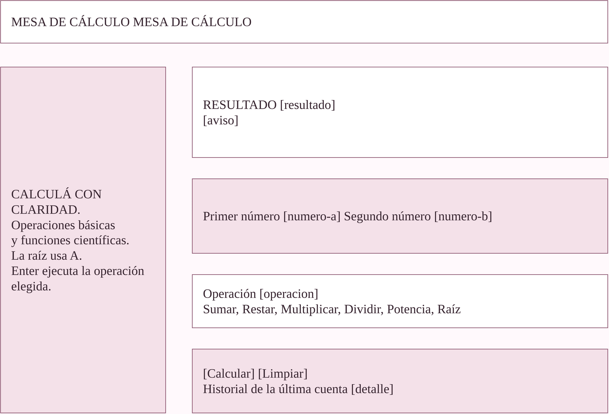
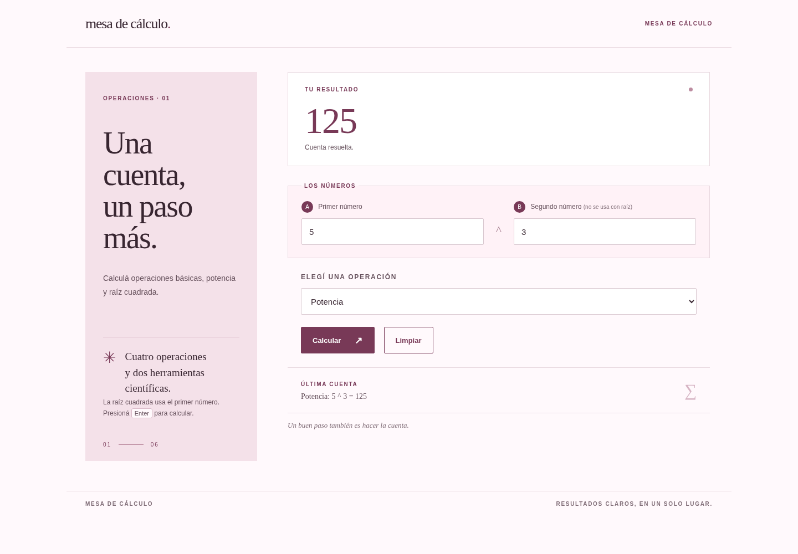

# Mesa de cálculo

## 🧩 Datos generales

| Campo | Detalle |
| --- | --- |
| Integrante 1 | Julieta Ini |
| Integrante 2 | No corresponde: trabajo individual |
| Modelos de IA utilizados | ChatGPT; GPT-6 Luna |
| Tecnologías del proyecto | HTML5, CSS3, JavaScript, Markdown, GitHub |
| Link del repositorio | [Mesa de cálculo](https://github.com/juliini2/calculadora-cientifica) |

## Uso

Calculadora independiente para sumar, restar, multiplicar, dividir, elevar el primer valor al segundo y obtener la raíz cuadrada del primer valor. La raíz no requiere el segundo valor. Incluye validaciones de entradas y resultados, y conserva la interacción y presentación propias de esta aplicación.

## Registro de iteración

### Encargos nuevos

### Encargo 1 — identidad

```text
Encargo 1: Actualizá únicamente la identidad visible de esta calculadora: título de página, metadatos de descripción, cabecera y nombres accesibles. Usá el título «Mesa de cálculo» y una descripción breve de utilidad general. Quitá marcas y referencias a estudio o tutorías. Conservá estructura, estilos, distribución, IDs y comportamiento.
```

### Encargo 2 — textos auxiliares

```text
Encargo 2: Neutralizá los textos auxiliares, etiquetas y referencias visibles de esta calculadora para que describan sus operaciones y validaciones con lenguaje utilitario. Quitá menciones a comunidad, estudio, tutorías y marcas. Conservá las operaciones, validaciones, accesibilidad, estructura, distribución y estilos; no cambies IDs, valores persistidos ni funciones.
```

### Encargo 3 — boceto y documentación

```text
Encargo 3: Actualizá el boceto editable existente conservando geometría y distribución, y escribí README.md y documentacion.md idénticos. Describí la calculadora como herramienta independiente. Incluí la tabla general pedida, Uso, Registro de iteración con el error real previo y su prompt de corrección exacto, Estado local pendiente de publicación, enlaces al repositorio e historial por SHA y referencias de evidencia sin afirmar capturas nuevas. No incluyas secciones de diferencias, herramientas, decisiones ni pruebas.
```

### Corrección registrada anteriormente

La suma 0.1 + 0.2 se mostraba como 0.30000000000000004 y el símbolo entre los operandos no acompañaba siempre a la operación elegida. El registro histórico describe el formato 0,3 y el símbolo correspondiente.

Prompt de corrección original:

```text
Formateá el resultado y el detalle de la cuenta en español, con hasta 12 cifras significativas: 0.1 + 0.2 debe verse como 0,3, sin redondear valores pequeños a cero. Mantené la precisión interna. El símbolo entre los campos debe acompañar la operación elegida, no mostrar siempre un signo de suma.
```

El registro previo documenta la corrección de ese comportamiento. El contexto completo anterior permanece en el [README histórico](https://github.com/juliini2/calculadora-cientifica/blob/c94560990fc446d68b8f8afe6d00e09bc68a7728/README.md).


## Estado

Cambios realizados localmente. La publicación queda pendiente de decisión del usuario.

## Enlaces

- [Repositorio](https://github.com/juliini2/calculadora-cientifica)
- [Registro anterior en GitHub](https://github.com/juliini2/calculadora-cientifica/blob/c94560990fc446d68b8f8afe6d00e09bc68a7728/README.md)

## Capturas actuales

Boceto de la interfaz:



Aplicación funcionando con datos de ejemplo:



[Ver captura móvil](evidencias/aplicacion-movil.png).

Estas capturas corresponden a la versión local. El repositorio y el sitio publicados todavía conservan la versión anterior.
